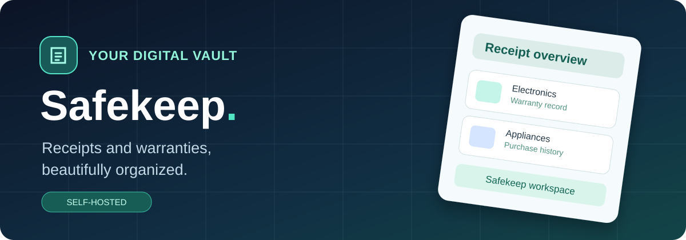
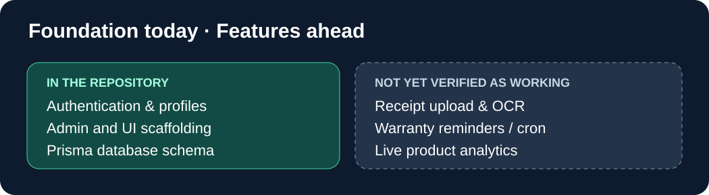
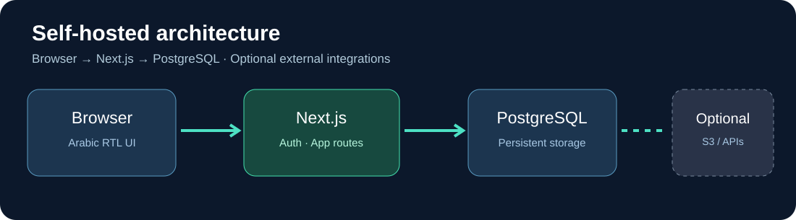

<div align="center">



# Safekeep

**A self-hosted foundation for receipt and warranty management.**

منصة عربية قيد التطوير لتنظيم الفواتير وضمانات المنتجات.

   

[Quick start](#quick-start) · [Project status](#project-status) · [Architecture](#architecture) · [Portainer](#docker-and-portainer) · [العربية](#العربية)

</div>

> [!IMPORTANT]
> **Development project — not a production-ready warranty service.** The current repository contains authentication, administration, Prisma models and dashboard UI, but dashboard metrics are hardcoded demo values. Full receipt upload, OCR processing and scheduled warranty notifications were not found as completed end-to-end routes during this review. The illustrations below are **concept artwork**, not screenshots of verified functionality.

## Why Safekeep?

Safekeep aims to give households and teams a single place to track their purchases, retain receipt information, and understand warranty timelines, with an Arabic RTL interface and self-hosted infrastructure.



## Project status

| Area | Current repository status |
|---|---|
| Arabic RTL interface and landing page | Present |
| Login, registration, user profile and admin API routes | Present; requires deployment testing |
| Prisma models for products, receipts and warranties | Present |
| Dashboard | UI demo with **hardcoded** counts and indicators |
| Invoice image/PDF upload | Not verified as implemented end-to-end |
| Google Vision OCR | Not verified as implemented end-to-end |
| Expiry reminder scheduler and email alerts | Not verified as implemented end-to-end |
| AWS S3 | Environment placeholders; integration must be verified |
| Docker and Portainer | Deployment files exist; full build not validated in this review |

## Architecture



**Technology:** Next.js 15, TypeScript, Prisma, PostgreSQL 16, NextAuth.js, Tailwind CSS and Docker. The codebase also declares AWS S3 and Google Cloud-related integration settings; enabling an environment variable does not mean that a feature is implemented.

## Quick start

For local development, install Node.js 20+, a supported PostgreSQL server and dependencies:

```bash
git clone https://github.com/ThamerLab/Safekeep.git
cd Safekeep
npm install --legacy-peer-deps
cp .env.example .env
# Set DATABASE_URL, NEXTAUTH_URL, NEXTAUTH_SECRET and database credentials
npx prisma generate
npx prisma migrate deploy
npm run dev
```

Open [http://localhost:3000](http://localhost:3000).

> **Do not run** `prisma db seed` with its current default credentials on an exposed deployment. The seed script creates known demo/admin accounts unless you set `SEED_ADMIN_EMAIL`, `SEED_ADMIN_PASSWORD`, `SEED_DEMO_EMAIL` and `SEED_DEMO_PASSWORD` securely. Review `prisma/seed.ts` before running it.

## Docker and Portainer

```bash
cp .env.example .env
# Update ALL credentials, NEXTAUTH_URL and PostgreSQL settings
docker compose up -d --build
docker compose ps
```

The Compose stack includes a PostgreSQL service and a Next.js app and runs `prisma migrate deploy` at app startup. In Portainer, use a Git-backed stack or make the repository build context available; pasting Compose alone may not provide the application source needed by `build: .`. See [PORTAINER.md](PORTAINER.md) and [DEPLOYMENT.md](DEPLOYMENT.md).

> [!CAUTION]
> Safekeep stores account and purchase-related information. Use HTTPS, strong secrets, restricted network access and PostgreSQL backups. Do not publish an instance with demo accounts. Avoid exposing the database port. Test login, database migrations, and any enabled external integrations before public access.

## Repository overview

```text
src/app/                 Next.js pages and API routes
src/components/          Shared UI and app shell
src/lib/                 Authentication, environment, database helpers
prisma/                  Database schema, migration and seed script
Dockerfile               Application image
docker-compose.yml       App + PostgreSQL services
DEPLOYMENT.md            General deployment notes
PORTAINER.md             Portainer-specific guide
docs/images/             README concept illustrations
```

## Next priorities

1. Implement and test real receipt/product CRUD and secure upload storage.
2. Add OCR with explicit user consent, error handling and clear data-processing boundaries.
3. Implement warranty expiry calculation and scheduled notifications.
4. Replace demo statistics with authenticated, user-scoped database queries.
5. Add automated build, migration, security and end-to-end tests before labeling this production-ready.

## العربية

**Safekeep** مشروع لتنظيم فواتير المشتريات وضمانات المنتجات داخل منصة عربية. الموجود حاليًا يشمل هيكل التطبيق، التسجيل والدخول، إدارة الحسابات، قاعدة بيانات Prisma وواجهات أولية. **بعض أرقام لوحة التحكم تجريبية وثابتة**، ولا ينبغي التعامل معها على أنها بيانات حقيقية.

لتشغيله منزليًا استخدم Docker Compose أو Portainer بعد ضبط قاعدة البيانات ومفاتيح المصادقة. لا تستخدم كلمات المرور التجريبية الموجودة في ملف التهيئة الأولية. قبل تعريض الخدمة للإنترنت تأكد من عمل المزايا فعليًا ومن إعداد HTTPS والنسخ الاحتياطي.

## Contributing and license

Issues and pull requests are welcome. Do not include invoices, personal receipts or credentials in bug reports. **A license file is not present in the repository as reviewed**; reuse and redistribution rights should be clarified by the maintainer before labeling the project open source under a specific license.

Maintained by [ThamerLab](https://github.com/ThamerLab).
